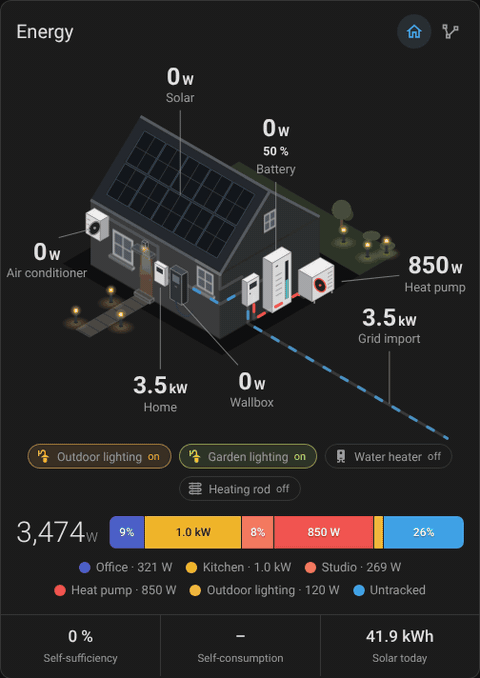
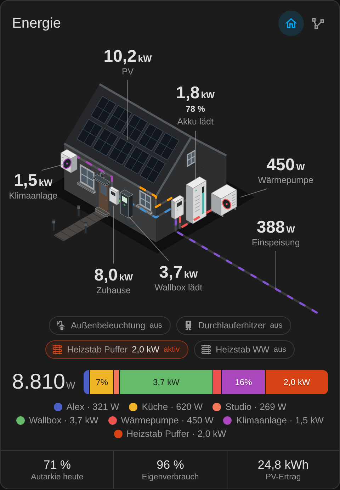
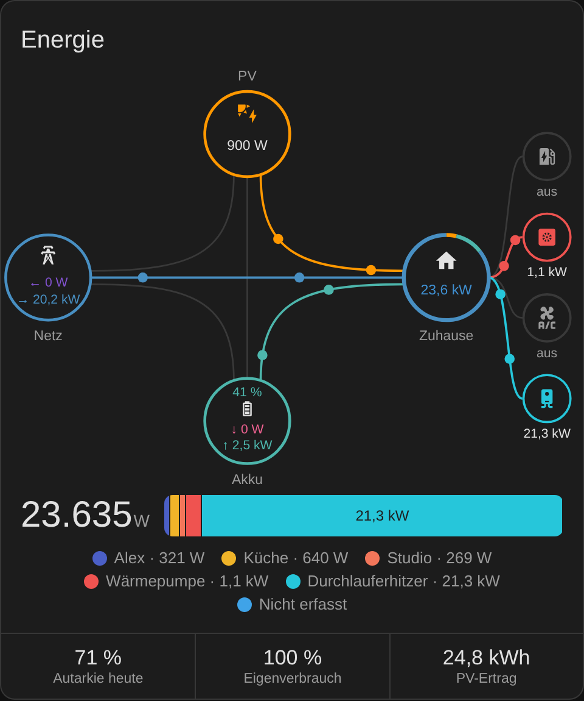
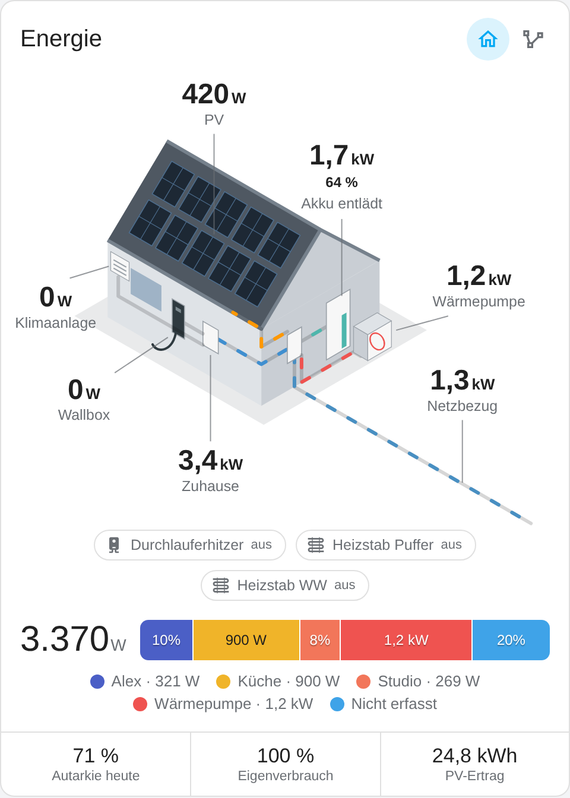
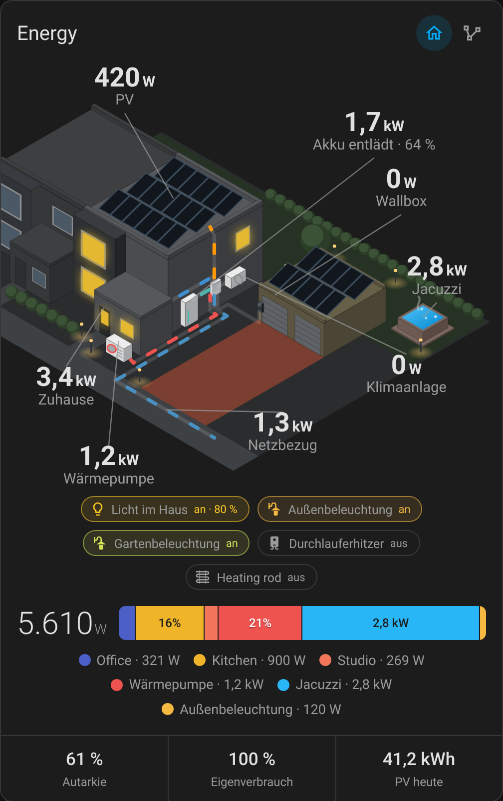

<div align="center">

# Very Custom Energy House Card

**Your whole energy system in one Home Assistant card – solar, battery, grid, big appliances and every consumer, drawn as a little house.**

[](https://hacs.xyz/docs/faq/custom_repositories)
[](https://github.com/Pfillip/very-custom-energy-house-card/releases/latest)
[](https://github.com/Pfillip/very-custom-energy-house-card/actions/workflows/build.yml)
[](LICENSE)

[**▶ Try the live demo**](https://pfillip.github.io/very-custom-energy-house-card/) · [Install](#installation) · [Configuration](#configuration) · [Changelog](CHANGELOG.md)



</div>

## Highlights

| | |
| --- | --- |
| 🏠 **House view** | An isometric house with solar roof, windows, front door and garden. Inverter, battery, wallbox, heat pump and air conditioner sit on the walls as 3D units. Cables light up in the color of the energy source and run in the direction of the flow. |
| 🏘️ **Two house motifs** | A detached house with gable roof, or an end-of-terrace house with flat roof, neighbour, two garages with PV and a back garden (`house_style: terraced`). |
| 🔀 **Flow view** | Solar, grid, battery and home as nodes with all six flow paths. Dots move faster with more power; the ring around *Home* shows where the energy comes from. |
| 🔌 **Large appliances** | Wallbox, heat pump, air conditioner, instantaneous water heater and any number of heating rods. Each one only appears once it is configured; water heater and heating rods can hide while inactive. |
| 💡 **Lighting** | Front garden (light above the door, bollards along the walkway), back garden and the lights inside the house – the windows glow, dimmed to the light's brightness. Each follows its own light or switch. |
| 📊 **Consumption bar** | Your consumers and the large appliances as one stacked bar. Whatever is not covered shows up as *Untracked*. |
| 🔢 **Key figures** | Three slots with your own entities and names, or live self-sufficiency and self-consumption. Hide them completely if you don't need them. |
| 🎨 **Fits your dashboard** | Visual editor, light and dark themes, energy colors from your theme, English and German. Clicking anything opens its more-info dialog. |

## Live demo

The [live demo](https://pfillip.github.io/very-custom-energy-house-card/) runs the real card with simulated sensor values. Switch the time of day, the lights, the theme and the language to see how the card reacts.

## Installation

### HACS (recommended)

[](https://my.home-assistant.io/redirect/hacs_repository/?owner=Pfillip&repository=very-custom-energy-house-card&category=plugin)

Or by hand:

1. Open HACS → ⋮ → **Custom repositories**.
2. Add `https://github.com/Pfillip/very-custom-energy-house-card` with type **Dashboard**.
3. Search for **Very Custom Energy House Card** and download it.
4. Reload the browser.

### Manual

1. Download `very-custom-energy-house-card.js` from the [latest release](https://github.com/Pfillip/very-custom-energy-house-card/releases/latest).
2. Copy it to `config/www/`.
3. Add it as a dashboard resource: **Settings → Dashboards → ⋮ → Resources**, URL `/local/very-custom-energy-house-card.js`, type *JavaScript module*.

## Configuration

Add the card through **Add card → Very Custom Energy House Card** and set it up in the visual editor. A minimal YAML configuration needs just your energy sensors:

```yaml
type: custom:very-custom-energy-house-card
entities:
  pv: sensor.pv_power
  grid: sensor.grid_power         # + import / − export
  battery: sensor.battery_power   # + discharge / − charge
  battery_soc: sensor.battery_soc
```

<details>
<summary><b>Full example</b></summary>

```yaml
type: custom:very-custom-energy-house-card
title: Energie
view: switch                          # house | flow | switch
entities:
  pv: sensor.pv_power
  grid: sensor.grid_power
  grid_invert: false
  battery: sensor.battery_power
  battery_invert: false
  battery_soc: sensor.battery_soc
  home: sensor.house_consumption      # optional, calculated if omitted
devices:
  wallbox:
    entity: sensor.wallbox_power
    color: "#66bb6a"
  heat_pump:
    entity: sensor.heat_pump_power
  air_conditioner:
    entity: sensor.air_conditioner_power
  water_heater:
    entity: sensor.water_heater_power
    hide_inactive: true
  heating_rods:
    hide_inactive: true
    entities:
      - entity: sensor.heating_rod_buffer_power
        name: Heizstab Puffer
  lighting:                           # front garden
    entity: light.front_garden        # light, switch or input_boolean
    power: sensor.front_garden_power  # optional, adds it to the bar
  garden_lighting:                    # back garden
    entity: light.back_garden
  indoor_lighting:                    # windows glow
    entity: light.living_room
    brightness: input_number.window_glow  # optional
consumers:
  - entity: sensor.kitchen_power
    name: Küche
    color: "#f0b429"
kpis:
  autarky:                            # no entity = calculated live
    name: Autarkie
  self_consumption:
    entity: sensor.self_consumption_today
    name: Eigenverbrauch heute
  pv_today:                           # only shown with an entity
    entity: sensor.pv_energy_today
    name: PV heute
show_consumers: true
show_kpis: true
animation: true
active_threshold: 10
total_font_weight: light              # light | regular | medium | bold
untracked_color: "#3fa3e8"
```

</details>

### Options

**General**

| Option | Type | Default | Description |
| --- | --- | --- | --- |
| `title` | string | – | Card title. |
| `view` | `house` \| `flow` \| `switch` | `switch` | Fixed view, or `switch` to show view buttons in the card. |
| `house_style` | `classic` \| `terraced` | `classic` | House motif: detached house with gable roof, or end-of-terrace house with flat roof and garages. |
| `show_consumers` | boolean | `true` | Show the consumption bar. |
| `show_kpis` | boolean | `true` | Show the key figures. `false` hides them completely. |
| `animation` | boolean | `true` | Animate the flows. |
| `active_threshold` | number | `10` | Power in W from which an appliance counts as active. |
| `total_font_weight` | `light` \| `regular` \| `medium` \| `bold` | `light` | Font weight of the total next to the consumption bar. |
| `untracked_color` | color | `#3fa3e8` | Color of the *Untracked* segment. |
| `label_scale` | number (80–200) | `100` | Size of the labels in the house and flow drawing, in percent. Labels stay inside the drawing. |

**Sources** (`entities`)

| Option | Type | Description |
| --- | --- | --- |
| `pv` | entity | Solar power. |
| `grid` | entity | Grid power, positive = import, negative = export. |
| `grid_invert` | boolean | Invert the grid sign. |
| `battery` | entity | Battery power, positive = discharge, negative = charge. |
| `battery_invert` | boolean | Invert the battery sign. |
| `battery_soc` | entity | Battery state of charge in %. |
| `home` | entity | Home consumption. Calculated from solar + grid + battery if omitted. |

**Appliances and lighting** (`devices`) – each one only appears once it has an entity. Every appliance also takes an optional `color` (hex, e.g. `"#e91e63"`) for its cable, node, chip and bar segment.

| Option | Fields | Description |
| --- | --- | --- |
| `wallbox` | `entity`, `name` | Wallbox on the front wall. |
| `heat_pump` | `entity`, `name` | Outdoor unit next to the gable wall. |
| `air_conditioner` | `entity`, `name` | Wall-mounted outdoor unit. |
| `jacuzzi` | `entity`, `name` | Hot tub. In the terraced motif it shows up – bubbling and steaming – in the back garden while it is running. |
| `water_heater` | `entity`, `name`, `hide_inactive` | Shown as a chip below the house. |
| `heating_rods` | `entities` (list of `entity`, `name`, `color`), `hide_inactive` | Shown as chips below the house. |
| `lighting` | `entity`, `power`, `name` | Front garden lighting. `entity` is a light, switch or input_boolean; the optional `power` sensor adds it to the bar. |
| `garden_lighting` | `entity`, `power`, `name` | Back garden lighting, same options. |
| `indoor_lighting` | `entity`, `brightness`, `power`, `name` | Lights inside the house: the windows glow while `entity` is on. The glow follows the light's own brightness, or an optional `brightness` entity (number, input_number or sensor; 0–100 % or 0–255). |

**Consumers and key figures**

| Option | Fields | Description |
| --- | --- | --- |
| `consumers` | `entity`, `name`, `color` | Segments of the consumption bar. |
| `kpis.autarky` | `entity`, `name` | Key figure 1. Without entity: live self-sufficiency. |
| `kpis.self_consumption` | `entity`, `name` | Key figure 2. Without entity: live self-consumption. |
| `kpis.pv_today` | `entity`, `name` | Key figure 3. Only shown with an entity. |

Power sensors may report W, kW or MW; values are converted automatically.

### Bar card

The package contains a second card, **Very Custom Energy Bar Card**, with just the consumption bar: total, stacked bar and legend, plus optional key figures and chips. Use it to place the bar somewhere else than the house – for example the house on an overview page and the bar next to your room cards. For a house without bar, turn off `show_consumers` and `show_kpis` in the house card.

```yaml
type: custom:very-custom-energy-bar-card
title: Verbrauch
entities:
  pv: sensor.pv_power          # needed to calculate the home consumption …
  grid: sensor.grid_power
  battery: sensor.battery_power
  # home: sensor.house_consumption   # … or set it directly
consumers:
  - entity: sensor.kitchen_power
    name: Küche
show_chips: false              # lighting and appliance chips above the bar
show_kpis: true
```

It takes the same configuration as the house card, so you can copy the YAML from one card to the other; options that only concern the house are ignored.

### Size and layout

The card adapts to the space it gets – there is nothing to configure:

- **Sections dashboard**: resize the card in the *Layout* tab like any built-in card. With *automatic height* the drawing keeps its natural proportions; with a fixed height it shrinks or grows to fill the card, and the bar and key figures scroll if space gets really tight.
- **Wide cards** (about 720 px and more): the drawing moves to the left and chips, consumption bar and key figures sit next to it.
- **Text** of the bar, legend and key figures grows and shrinks with the card width.

## Screenshots

| House view | Flow view | Light theme |
| --- | --- | --- |
|  |  |  |

**End-of-terrace motif** (`house_style: terraced`):



*Screenshots use simulated sensor values.*

## Troubleshooting

- **The editor or card looks like an older version after an update.** Your browser still has the old file cached. Reload the page with an empty cache, or restart the Home Assistant app on your phone.
- **Import and export (or charging and discharging) are swapped.** Turn on `grid_invert` or `battery_invert` – some meters report the opposite sign.
- **An appliance does not show up.** Appliances only appear once a sensor is set. Water heater and heating rods with `hide_inactive` only appear while they draw more than `active_threshold`.

## Development

```bash
npm install
npm run watch
```

Serve the repository root (for example with `python3 -m http.server`) and open `http://localhost:8000/demo/` for the demo page, `http://localhost:8000/dev/` for the test page or `http://localhost:8000/dev/sizes.html` to compare card sizes.

Releases are built by GitHub Actions: publish a release with a tag like `v0.5.0` and the workflow attaches `very-custom-energy-house-card.js`. The demo is published to GitHub Pages on every push to `main`.

## License

[MIT](LICENSE)
