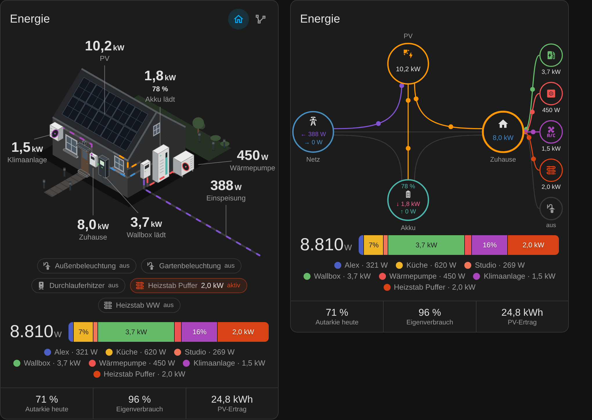
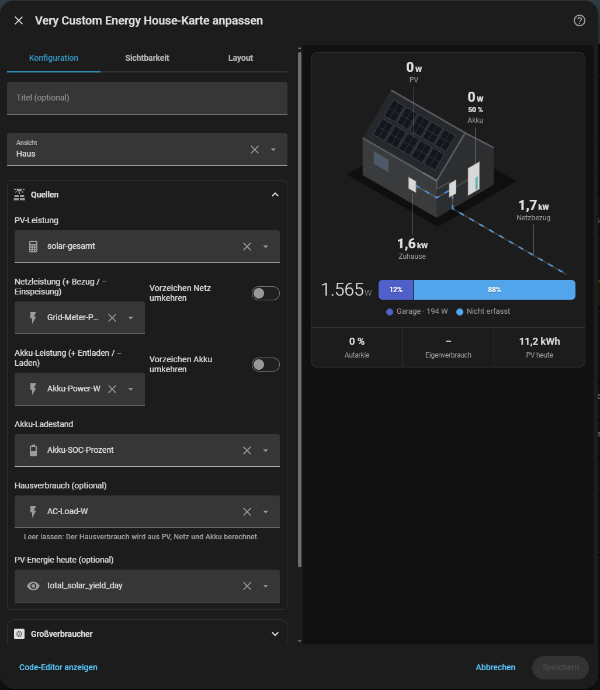

# Very Custom Energy House Card

[](https://hacs.xyz/docs/faq/custom_repositories)
[](https://github.com/Pfillip/very-custom-energy-house-card/actions/workflows/build.yml)

A Home Assistant dashboard card that shows your whole energy system in one place:



- **House view** – an isometric house with solar roof, inverter, battery and grid connection. Cables light up in the color of the energy source and run in the direction of the flow.
- **Flow view** – solar, grid, battery and home as nodes with all six flow paths. Dot speed follows the power, the ring around *Home* shows where the energy comes from.
- **Large appliances** – wallbox, heat pump, air conditioner, instantaneous water heater and any number of heating rods. Each one only appears once it is configured; water heater and heating rods can be hidden while inactive.
- **Consumption bar** – your consumers and the large appliances as a stacked bar. Whatever is not covered shows up as *Untracked*.
- **Key figures** – three slots with your own entities and names. Without an entity, the first two show live self-sufficiency and self-consumption.

Everything can be configured in the visual editor. Colors follow the Home Assistant energy dashboard theme variables, light and dark themes are supported, and the card is translated into English and German.

## Screenshots

| House view | Flow view | Light theme |
| --- | --- | --- |
|  |  |  |

*Screenshots use simulated sensor values from `dev/index.html`.*

### Visual editor



## Installation

### HACS (recommended)

1. Open HACS → ⋮ → **Custom repositories**.
2. Add `https://github.com/Pfillip/very-custom-energy-house-card` with type **Dashboard**.
3. Search for **Very Custom Energy House Card** and download it.
4. Reload the browser.

### Manual

1. Download `very-custom-energy-house-card.js` from the [latest release](https://github.com/Pfillip/very-custom-energy-house-card/releases/latest).
2. Copy it to `config/www/`.
3. Add it as a dashboard resource: **Settings → Dashboards → ⋮ → Resources**, URL `/local/very-custom-energy-house-card.js`, type *JavaScript module*.

## Configuration

Add the card through **Add card → Very Custom Energy House Card** and use the visual editor, or use YAML:

```yaml
type: custom:very-custom-energy-house-card
title: Energie
view: switch            # house | flow | switch
entities:
  pv: sensor.pv_power
  grid: sensor.grid_power           # + import / − export
  grid_invert: false
  battery: sensor.battery_power     # + discharge / − charge
  battery_invert: false
  battery_soc: sensor.battery_soc
  home: sensor.house_consumption    # optional, calculated if omitted
devices:
  wallbox:
    entity: sensor.wallbox_power
  heat_pump:
    entity: sensor.heat_pump_power
  air_conditioner:
    entity: sensor.air_conditioner_power
  water_heater:
    entity: sensor.water_heater_power
    hide_inactive: true
  heating_rods:
    hide_inactive: true
    entities:
      - entity: sensor.heating_rod_buffer_power
        name: Heizstab Puffer
consumers:
  - entity: sensor.kitchen_power
    name: Küche
    color: "#f0b429"
kpis:
  autarky:                          # empty entity = calculated live
    name: Autarkie
  self_consumption:
    entity: sensor.self_consumption_today
    name: Eigenverbrauch heute
  pv_today:                         # only shown with an entity
    entity: sensor.pv_energy_today
    name: PV heute
show_consumers: true
show_kpis: true
animation: true
active_threshold: 10
```

### Options

| Option | Type | Default | Description |
| --- | --- | --- | --- |
| `title` | string | – | Card title. |
| `view` | `house` \| `flow` \| `switch` | `switch` | Fixed view, or `switch` to show view buttons in the card. |
| `entities.pv` | entity | – | Solar power. |
| `entities.grid` | entity | – | Grid power, positive = import, negative = export. |
| `entities.grid_invert` | boolean | `false` | Invert the grid sign. |
| `entities.battery` | entity | – | Battery power, positive = discharge, negative = charge. |
| `entities.battery_invert` | boolean | `false` | Invert the battery sign. |
| `entities.battery_soc` | entity | – | Battery state of charge in %. |
| `entities.home` | entity | – | Home consumption. Calculated from solar + grid + battery if omitted. |
| `devices.wallbox` | object | – | `entity`, optional `name`. |
| `devices.heat_pump` | object | – | `entity`, optional `name`. |
| `devices.air_conditioner` | object | – | `entity`, optional `name`. |
| `devices.water_heater` | object | – | `entity`, optional `name`, `hide_inactive`. |
| `devices.heating_rods` | object | – | `entities` (list of `entity`, `name`), `hide_inactive`. |
| `consumers` | list | `[]` | `entity`, optional `name` and `color`. |
| `kpis.autarky` | object | – | Key figure 1: `entity`, `name`. Without entity: live self-sufficiency. |
| `kpis.self_consumption` | object | – | Key figure 2: `entity`, `name`. Without entity: live self-consumption. |
| `kpis.pv_today` | object | – | Key figure 3: `entity`, `name`. Only shown with an entity. |
| `show_consumers` | boolean | `true` | Show the consumption bar. |
| `show_kpis` | boolean | `true` | Show the key figures row. |
| `animation` | boolean | `true` | Animate the flows. |
| `active_threshold` | number | `10` | Power in W from which a device counts as active. |

Power sensors may report W, kW or MW; values are converted automatically. Clicking a value, node, chip or bar segment opens the more-info dialog of its entity.

## Development

```bash
npm install
npm run watch
```

The `dev/index.html` page renders the card with simulated sensor values. Serve the repository root, e.g. with `python3 -m http.server`, and open `http://localhost:8000/dev/`.

A release is built by GitHub Actions: publish a GitHub release with a tag like `v0.1.0`, and the workflow attaches `very-custom-energy-house-card.js` to it.

## License

MIT
