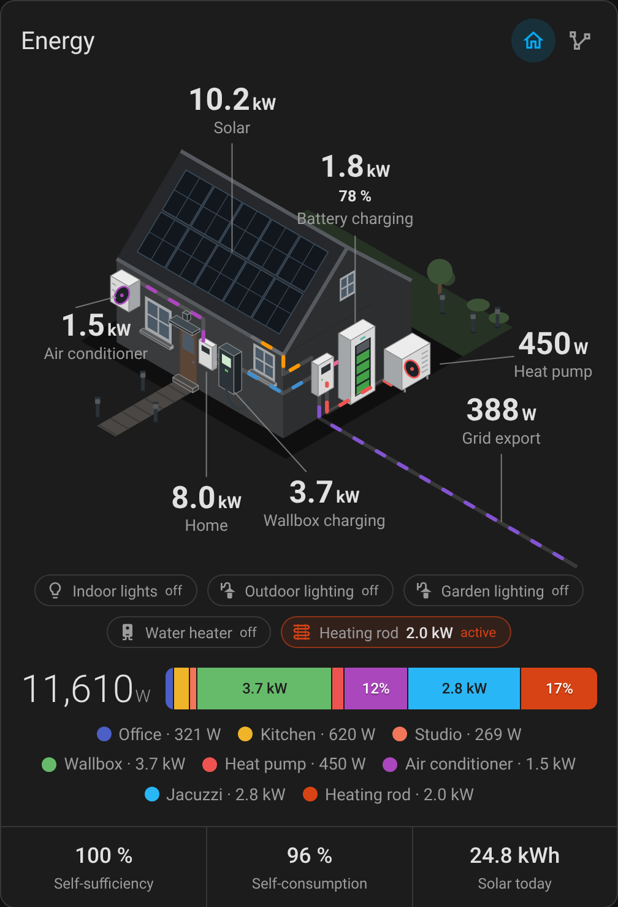
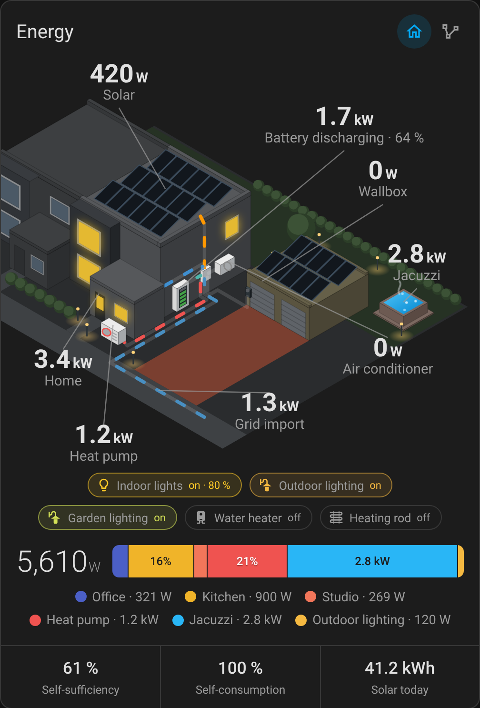
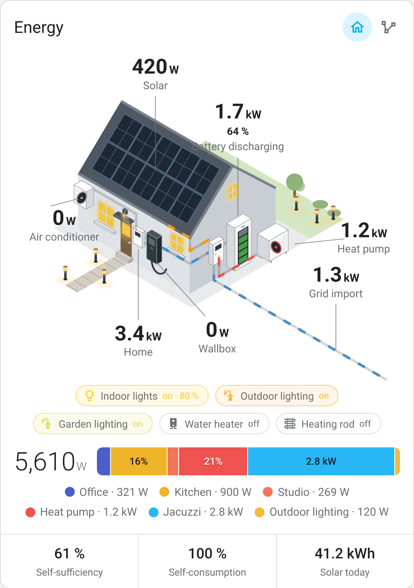
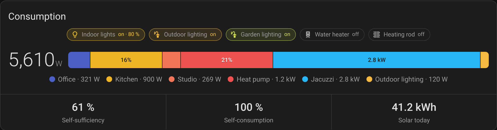

<div align="center">

# Very Custom Energy House Card

**Your whole energy system as a little house – solar, battery, grid, big appliances, lighting and every consumer in one Home Assistant card.**

[](https://hacs.xyz/docs/faq/custom_repositories)
[](https://github.com/Pfillip/very-custom-energy-house-card/releases/latest)
[](https://github.com/Pfillip/very-custom-energy-house-card/actions/workflows/build.yml)
[](LICENSE)

[**▶ Live demo**](https://pfillip.github.io/very-custom-energy-house-card/) · [Installation](#installation) · [Quick start](#quick-start) · [Options](#options) · [Changelog](CHANGELOG.md)


</div>

## Two motifs, two cards

<table>
  <tr>
    <td width="50%" valign="top">
      
      <p align="center"><b>Detached house</b><br><sub><code>house_style: classic</code></sub></p>
    </td>
    <td width="50%" valign="top">
      
      <p align="center"><b>End-of-terrace house</b> with garages and back garden<br><sub><code>house_style: terraced</code></sub></p>
    </td>
  </tr>
  <tr>
    <td width="50%" valign="top">
      
      <p align="center"><b>Flow view</b><br><sub><code>view: flow</code> or switchable in the card</sub></p>
    </td>
    <td width="50%" valign="top">
      
      <p align="center"><b>Light and dark themes</b><br><sub>colors follow your Home Assistant theme</sub></p>
    </td>
  </tr>
  <tr>
    <td colspan="2" valign="top">
      
      <p align="center"><b>Bar card</b> – the consumption bar as a card of its own<br><sub><code>custom:very-custom-energy-bar-card</code></sub></p>
    </td>
  </tr>
</table>

<sub>All pictures use simulated sensor values. Try them yourself in the <a href="https://pfillip.github.io/very-custom-energy-house-card/">live demo</a>.</sub>

## Features

- 🏠 **House view** – an isometric house with solar roof, windows, door and garden. Inverter, battery, wallbox, heat pump and air conditioner hang on the walls as 3D units; cables light up in the color of the energy source and run in the direction of the flow.
- 🔋 **Battery at a glance** – the battery front is a 5-segment gauge: red below 20 %, amber below 50 %, green above.
- 🔀 **Flow view** – solar, grid, battery and home with all six flow paths. Dots move faster with more power; the ring around *Home* shows where the energy comes from.
- 🔌 **Large appliances** – wallbox, heat pump, air conditioner, jacuzzi, instantaneous water heater and any number of heating rods. Each appears only once it is configured; some can hide while inactive.
- 💡 **Lighting** – front garden, back garden and indoor lights. Windows glow dimmed to the light's brightness, bollards light the walkway and the garden.
- 📊 **Consumption bar** – your consumers and the large appliances as one stacked bar; whatever is not covered shows up as *Untracked*. Also available as its own card.
- 🔢 **Key figures** – three slots with your own entities and names, or live self-sufficiency and self-consumption. Or none at all.
- 🎨 **Fits your dashboard** – visual editor, custom colors for every consumer, adjustable label size, sections layout with free height, side-by-side layout on wide cards, English and German. Clicking anything opens its more-info dialog.

## Installation

### Marketplace / HACS (recommended)

[](https://my.home-assistant.io/redirect/marketplace_repository/?owner=Pfillip&repository=very-custom-energy-house-card&category=plugin)
[](https://my.home-assistant.io/redirect/hacs_repository/?owner=Pfillip&repository=very-custom-energy-house-card&category=plugin)

The first button opens the Marketplace (Home Assistant 2026.11 and later), the second one HACS – it also reaches the Marketplace on newer versions. If the card is not listed yet, both offer to add it as a custom repository.

Or by hand: HACS → ⋮ → **Custom repositories** → add `https://github.com/Pfillip/very-custom-energy-house-card` with type **Dashboard**, then download **Very Custom Energy House Card** and reload the browser.

<details>
<summary>Manual installation</summary>

1. Download `very-custom-energy-house-card.js` from the [latest release](https://github.com/Pfillip/very-custom-energy-house-card/releases/latest).
2. Copy it to `config/www/`.
3. Add it as a dashboard resource: **Settings → Dashboards → ⋮ → Resources**, URL `/local/very-custom-energy-house-card.js`, type *JavaScript module*.

</details>

Both cards come in the same file – after installing you find **Very Custom Energy House Card** and **Very Custom Energy Bar Card** in the card picker.

## Quick start

Add the card via **Add card → Very Custom Energy House Card** and click through the visual editor. In YAML, your energy sensors are all it needs:

```yaml
type: custom:very-custom-energy-house-card
house_style: terraced            # or classic
entities:
  pv: sensor.pv_power
  grid: sensor.grid_power         # + import / − export
  battery: sensor.battery_power   # + discharge / − charge
  battery_soc: sensor.battery_soc
```

The **bar card** takes the same configuration – copy the YAML over and change the type:

```yaml
type: custom:very-custom-energy-bar-card
title: Verbrauch
entities:
  pv: sensor.pv_power
  grid: sensor.grid_power
  battery: sensor.battery_power
consumers:
  - entity: sensor.kitchen_power
    name: Küche
show_chips: false                # lighting and appliance chips above the bar
show_kpis: true
```

Want the house without the bar? Turn off `show_consumers` and `show_kpis` in the house card and place the bar card wherever you like.

<details>
<summary><b>Full example</b></summary>

```yaml
type: custom:very-custom-energy-house-card
title: Energie
view: switch                          # house | flow | switch
house_style: terraced                 # classic | terraced
entities:
  pv: sensor.pv_power
  grid: sensor.grid_power
  grid_invert: false
  battery: sensor.battery_power
  battery_invert: false
  battery_soc: sensor.battery_soc
  home: sensor.house_consumption      # optional, calculated if omitted
devices:
  wallbox:
    entity: sensor.wallbox_power
    color: "#66bb6a"
  heat_pump:
    entity: sensor.heat_pump_power
  air_conditioner:
    entity: sensor.air_conditioner_power
  jacuzzi:
    entity: sensor.jacuzzi_power
  water_heater:
    entity: sensor.water_heater_power
    hide_inactive: true
  heating_rods:
    hide_inactive: true
    entities:
      - entity: sensor.heating_rod_buffer_power
        name: Heizstab Puffer
  lighting:                           # front garden
    entity: light.front_garden        # light, switch or input_boolean
    power: sensor.front_garden_power  # optional, adds it to the bar
  garden_lighting:                    # back garden
    entity: light.back_garden
  indoor_lighting:                    # windows glow
    entity: light.living_room
    brightness: input_number.window_glow  # optional
consumers:
  - entity: sensor.kitchen_power
    name: Küche
    color: "#f0b429"
kpis:
  autarky:                            # no entity = calculated live
    name: Autarkie
  self_consumption:
    entity: sensor.self_consumption_today
    name: Eigenverbrauch heute
  pv_today:                           # only shown with an entity
    entity: sensor.pv_energy_today
    name: PV heute
show_consumers: true
show_kpis: true
animation: true
active_threshold: 10
label_scale: 120
total_font_weight: light              # light | regular | medium | bold
untracked_color: "#3fa3e8"
```

</details>

## Options

<details open>
<summary><b>General</b></summary>

| Option | Type | Default | Description |
| --- | --- | --- | --- |
| `title` | string | – | Card title. |
| `view` | `house` \| `flow` \| `switch` | `switch` | Fixed view, or `switch` for view buttons in the card. |
| `house_style` | `classic` \| `terraced` | `classic` | Detached house with gable roof, or end-of-terrace house with flat roof, garages and back garden. |
| `show_consumers` | boolean | `true` | Show the consumption bar. |
| `show_kpis` | boolean | `true` | Show the key figures. |
| `show_chips` | boolean | `false` | Bar card only: lighting and appliance chips above the bar. |
| `animation` | boolean | `true` | Animate flows, bubbles and steam. |
| `active_threshold` | number | `10` | Power in W from which an appliance counts as active. |
| `label_scale` | number (80–200) | `100` | Size of the labels in the drawing, in percent. |
| `total_font_weight` | `light` \| `regular` \| `medium` \| `bold` | `light` | Font weight of the total next to the bar. |
| `untracked_color` | color | `#3fa3e8` | Color of the *Untracked* segment. |

</details>

<details>
<summary><b>Sources</b> (<code>entities</code>)</summary>

| Option | Type | Description |
| --- | --- | --- |
| `pv` | entity | Solar power. |
| `grid` | entity | Grid power, positive = import, negative = export. |
| `grid_invert` | boolean | Invert the grid sign. |
| `battery` | entity | Battery power, positive = discharge, negative = charge. |
| `battery_invert` | boolean | Invert the battery sign. |
| `battery_soc` | entity | Battery state of charge in %. |
| `home` | entity | Home consumption. Calculated from solar + grid + battery if omitted. |

Power sensors may report W, kW or MW; values are converted automatically.

</details>

<details>
<summary><b>Appliances and lighting</b> (<code>devices</code>)</summary>

Each one only appears once it has an entity. Every entry also takes an optional `color` (hex, e.g. `"#e91e63"`) for its cable, node, chip and bar segment.

| Option | Fields | Description |
| --- | --- | --- |
| `wallbox` | `entity`, `name` | Wallbox on the wall or at the garage. |
| `heat_pump` | `entity`, `name` | Outdoor unit next to the house. |
| `air_conditioner` | `entity`, `name` | Wall-mounted outdoor unit. |
| `jacuzzi` | `entity`, `name` | Hot tub. In the terraced motif it shows up – bubbling and steaming – in the back garden while it runs. |
| `water_heater` | `entity`, `name`, `hide_inactive` | Chip below the house. |
| `heating_rods` | `entities` (list of `entity`, `name`, `color`), `hide_inactive` | Chips below the house. |
| `lighting` | `entity`, `power`, `name` | Front garden: light above the door and bollards along the walkway. `entity` is a light, switch or input_boolean; `power` adds it to the bar. |
| `garden_lighting` | `entity`, `power`, `name` | Back garden bollards, same options. |
| `indoor_lighting` | `entity`, `brightness`, `power`, `name` | The windows glow while `entity` is on, dimmed by the light's brightness or an optional `brightness` entity (number, input_number or sensor; 0–100 % or 0–255). |

</details>

<details>
<summary><b>Consumers and key figures</b></summary>

| Option | Fields | Description |
| --- | --- | --- |
| `consumers` | `entity`, `name`, `color` | Segments of the consumption bar. |
| `kpis.autarky` | `entity`, `name` | Key figure 1. Without entity: live self-sufficiency. |
| `kpis.self_consumption` | `entity`, `name` | Key figure 2. Without entity: live self-consumption. |
| `kpis.pv_today` | `entity`, `name` | Key figure 3. Only shown with an entity. |

</details>

### Size and layout

The cards adapt to the space they get:

- **Sections dashboard** – resize the card in the *Layout* tab like any built-in card. With a fixed height the drawing shrinks or grows to fill it.
- **Wide cards** (about 720 px and more) – chips, bar and key figures move next to the drawing.
- **Text** of the bar, legend and key figures follows the card width; the labels in the drawing follow `label_scale`.

## Troubleshooting

- **The card or editor still looks like the old version after an update.** Reload the page with an empty cache, or restart the Home Assistant app.
- **Import and export (or charging and discharging) are swapped.** Turn on `grid_invert` or `battery_invert` – some meters report the opposite sign.
- **An appliance does not show up.** It needs a sensor. Water heater and heating rods with `hide_inactive`, and the jacuzzi in the terraced motif, only appear while they draw more than `active_threshold`.

## Development

```bash
npm install
npm run watch
```

Serve the repository root (for example with `python3 -m http.server`) and open `/demo/` for the demo page, `/dev/` for the test page or `/dev/sizes.html` to compare card sizes.

Releases are built by GitHub Actions: publish a release with a tag like `v0.7.0` and the workflow attaches `very-custom-energy-house-card.js`. The demo is published to GitHub Pages on every push to `main`.

## License

[MIT](LICENSE)
